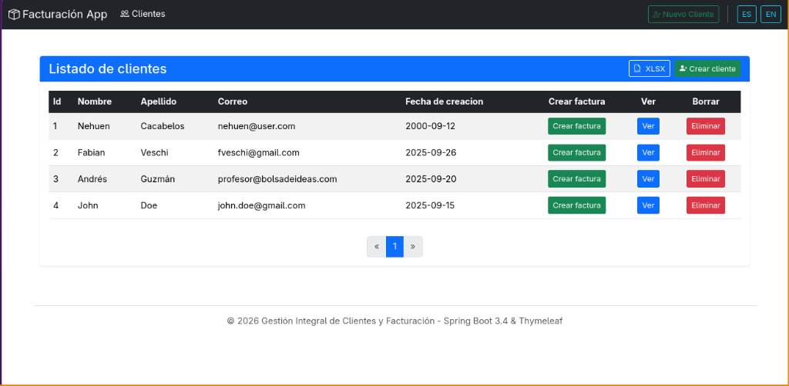
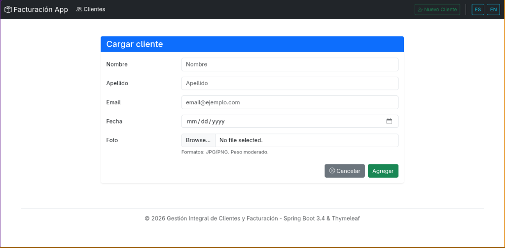
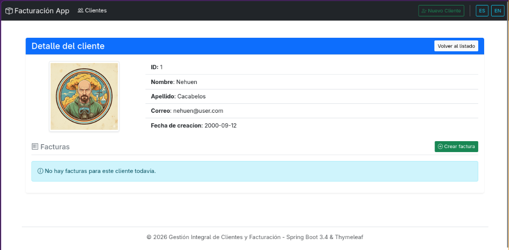
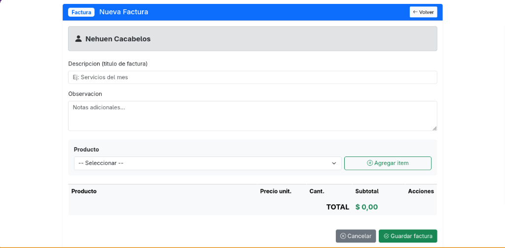
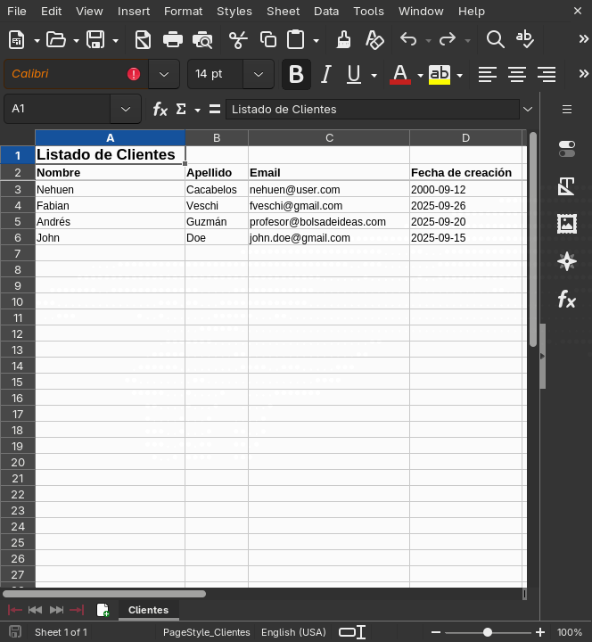

# 📊 Sistema de Gestión y Facturación con Spring Boot 3

[](https://www.oracle.com/java/)
[](https://spring.io/projects/spring-boot)
[](https://www.mysql.com/)
[](https://www.thymeleaf.org/)
[](https://getbootstrap.com/)
[](https://www.docker.com/)
[](https://poi.apache.org/)

Aplicación web integral para la administración de clientes, catálogo de productos y emisión de facturas electrónicas, desarrollada con una arquitectura robusta basada en **Spring Boot 3**, **Spring Data JPA**, **Thymeleaf**, **MySQL**, **Docker** y **Apache POI**.

---

## 📸 Capturas de Pantalla

### 1. Listado de Clientes con Paginación e Internacionalización
Visualización de clientes con paginación configurable, ordenamiento dinámico, selector de idioma (ES/EN) y descarga en Excel:


### 2. Formulario de Cliente con Subida de Fotos y Validaciones
Alta y edición de clientes con validación estricta de campos, manejo de errores del Binding y carga de imagen de perfil:


### 3. Detalle de Cliente y Facturas Emitidas
Ficha técnica del cliente con fotografía alojada en el servidor y listado histórico de sus facturas:


### 4. Emisión de Factura con Selección Dinámica de Productos
Creación interactiva de facturas mediante JavaScript: desplegable de productos, cálculo automático de cantidades, subtotales y gran total en tiempo real:


### 5. Exportación Automática a Planilla Excel (`.xlsx`)
Generación de documentos de hoja de cálculo nativos en el servidor utilizando Apache POI, con estilos tipográficos, formatos de fecha y columnas autoajustables:


---

## ✨ Características Principales

* **Gestión Integral de Clientes (CRUD)**:
  * Alta, consulta, edición y eliminación de clientes.
  * Subida de imágenes de perfil con nombre aleatorio único (`UUID`) y almacenamiento físico en el servidor mapeado mediante `WebMvcConfigurer`.
  * Validación declarativa con Bean Validation (`@NotEmpty`, `@Email`, `@NotNull`).
* **Módulo de Facturación**:
  * Emisión de comprobantes vinculados a clientes específicos.
  * Agregado dinámico de líneas de productos con cálculo de subtotales y validación de cantidad mínima.
  * Vista de detalle de factura con opción de impresión directa (`window.print()`).
* **Paginación y Ordenamiento Dinámico**:
  * Navegación por páginas mediante `Pageable` y `Sort` de Spring Data.
  * Barra de navegación interactiva con soporte para tamaño de página y dirección de ordenamiento.
* **Internacionalización y Multilenguaje (I18N)**:
  * Soporte multiidioma (Español / Inglés) configurable al instante desde la barra de navegación.
  * Interceptor de cambio de idioma (`LocaleChangeInterceptor`) y almacenamiento en sesión HTTP (`SessionLocaleResolver`).
  * Controlador de redirección contextual (`LocaleController`) utilizando el encabezado HTTP `Referer`.
* **Generación de Reportes en Excel**:
  * Exportación de clientes a formato Microsoft Excel OpenXML (`.xlsx`) mediante `AbstractXlsxView` y **Apache POI**.
  * Celdas estilizadas, encabezados destacados y congelación de paneles.
* **Semillero de Datos Automático (`DataLoader`)**:
  * Carga inicial idempotente de clientes, productos y facturas de demostración para pruebas inmediatas.

---

## 🛠️ Stack Tecnológico

| Capa | Tecnología |
|---|---|
| **Lenguaje** | Java 17 (OpenJDK) |
| **Framework Principal** | Spring Boot 3.4.1 |
| **Persistencia & ORM** | Spring Data JPA / Hibernate 6 |
| **Base de Datos** | MySQL 8.0 |
| **Motor de Plantillas** | Thymeleaf + Layout Dialect |
| **Frontend / UI** | Bootstrap 5.3, Bootstrap Icons |
| **Reportes Excel** | Apache POI 5.2.2 (`poi-ooxml`) |
| **Contenedores** | Docker & Docker Compose |
| **Gestor de Dependencias** | Apache Maven 3.9+ |

---

## 🚀 Instalación y Ejecución Local

### Prerrequisitos
* **Java 17** o superior instalado.
* **Docker & Docker Compose** (o un servidor MySQL local en el puerto 3306).

### 1. Clonar el repositorio
```bash
git clone git@github.com:NehuenCacabelos/sistema-facturacion-spring-boot.git
cd sistema-facturacion-spring-boot
```

### 2. Iniciar la Base de Datos con Docker
En la raíz del proyecto se incluye el archivo `docker-compose.yml` para desplegar MySQL 8 de forma inmediata:
```bash
docker compose up -d
```
> **Nota de credenciales**: El contenedor se configura con base `db_springboot`, usuario `root` y contraseña `root` en el puerto `3306`.

### 3. Ejecutar la Aplicación Spring Boot
Ingresá al subdirectorio `demo` y arrancá la aplicación con el Maven Wrapper:
```bash
cd demo
./mvnw spring-boot:run
```

La aplicación quedará disponible en:
👉 **`http://localhost:8080/listar`**

---

## 🌐 Endpoints Principales

| Método | Endpoint | Descripción |
|---|---|---|
| `GET` | `/listar` | Listado paginado de clientes con selector de idioma |
| `GET` | `/listar?format=xlsx` | Descarga directa de clientes en formato Excel (`.xlsx`) |
| `GET` | `/form` | Formulario para dar de alta un nuevo cliente |
| `POST` | `/form` | Procesa y persiste cliente con imagen de perfil |
| `GET` | `/form/{id}` | Edición de cliente existente |
| `GET` | `/ver/{id}` | Ficha de detalle del cliente y sus facturas asociadas |
| `GET` | `/nuevafactura/{id}` | Formulario interactivo para emitir factura a un cliente |
| `POST` | `/nuevafactura` | Guarda la factura con sus productos y cantidades |
| `GET` | `/facturas/{id}` | Detalle e impresión de comprobante de factura |
| `GET` | `/locale?lang={es_ES\|en_EN}` | Conmutador dinámico de idioma de la sesión |

---

## 📄 Licencia
Este proyecto fue desarrollado con fines educativos y de demostración técnica de capacidades full-stack con el ecosistema Spring Boot.
