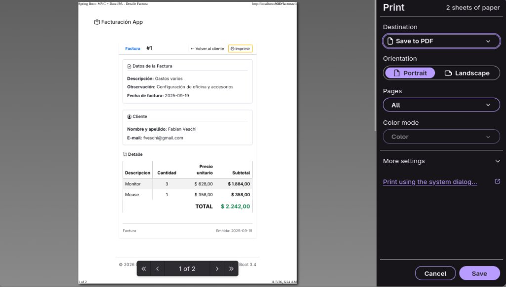

# 📊 Sistema de Gestión y Facturación con Spring Boot 3

[](https://www.oracle.com/java/)
[](https://spring.io/projects/spring-boot)
[](https://www.mysql.com/)
[](https://www.thymeleaf.org/)
[](https://getbootstrap.com/)
[](https://www.docker.com/)
[](https://poi.apache.org/)

Aplicación web integral para la administración de clientes, catálogo de productos y emisión de facturas electrónicas, desarrollada con una arquitectura robusta basada en **Spring Boot 3**, **Spring Data JPA**, **Thymeleaf**, **MySQL**, **Docker** y **Apache POI**.

---

## 📸 Capturas de Pantalla

### 1. Listado de Clientes con Paginación e Internacionalización
Visualización de clientes con paginación configurable, ordenamiento dinámico, selector de idioma (ES/EN) y botón de descarga directa en Excel:


### 2. Formulario de Cliente con Subida de Fotos y Validaciones
Alta y edición de clientes con validación declarativa de datos (Bean Validation), control de errores y carga de imagen de perfil:


### 3. Ficha Técnica del Cliente y Facturas Asociadas
Detalle del cliente con su fotografía almacenada en el servidor, datos de contacto y tabla histórica de facturas emitidas:


### 4. Emisión Interactiva de Facturas
Formulario dinámico con JavaScript: buscador y selector de catálogo de productos, cálculo automático de cantidades, subtotales y total general en tiempo real:


### 5. Exportación Automática a Planilla Excel (`.xlsx`)
Generación de documentos de hoja de cálculo nativos en el backend con Apache POI (`AbstractXlsxView`), con celdas estilizadas, formatos de fecha y columnas autoajustables:


### 6. Detalle de Factura, Impresión y Exportación a PDF
Vista completa del comprobante con líneas de detalle, totales y diálogo nativo de impresión para guardar o imprimir en PDF:


---

## ✨ Características Principales

* **Gestión Integral de Clientes (CRUD)**:
  * Alta, consulta, edición y eliminación de clientes.
  * Subida de imágenes de perfil con nombre aleatorio único (`UUID`) y almacenamiento físico en el directorio local `/uploads`, mapeado como recurso estático mediante `WebMvcConfigurer`.
  * Validación declarativa con Bean Validation (`@NotEmpty`, `@Email`, `@NotNull`).
* **Módulo de Facturación Electrónica**:
  * Emisión de comprobantes vinculados a clientes específicos.
  * Carga dinámica de líneas de factura con productos del catálogo y actualización reactiva de subtotales.
  * Vista de detalle de comprobante con opción de impresión directa (`window.print()`) y guardado en PDF.
* **Paginación y Ordenamiento Dinámico**:
  * Navegación por páginas mediante `Pageable` y `Sort` de Spring Data.
  * Barra de navegación interactiva con soporte para tamaño de página y dirección de ordenamiento.
* **Internacionalización y Multilenguaje (I18N)**:
  * Soporte multiidioma (Español / Inglés) configurable al instante desde el navbar.
  * Manejador de resolución de idioma por sesión (`SessionLocaleResolver`) e interceptor de parámetros (`LocaleChangeInterceptor`).
  * Controlador contextual (`LocaleController`) con redirección inteligente utilizando el header `Referer`.
* **Generación de Reportes en Excel**:
  * Exportación de clientes a formato Microsoft Excel OpenXML (`.xlsx`) mediante `AbstractXlsxView` y **Apache POI**.
  * Encabezados con estilos tipográficos, bordes, formatos de celda y paneles congelados.
* **Inicialización Automática de Datos (`DataLoader`)**:
  * Carga inicial idempotente al iniciar la aplicación con clientes de prueba, catálogo de productos de informática y facturas de ejemplo.

---

## 🛠️ Stack Tecnológico

| Capa | Tecnología |
|---|---|
| **Lenguaje** | Java 17 (OpenJDK) |
| **Framework Principal** | Spring Boot 3.4.1 |
| **Persistencia & ORM** | Spring Data JPA / Hibernate 6 |
| **Base de Datos** | MySQL 8.0 |
| **Motor de Plantillas** | Thymeleaf + Layout Dialect |
| **Frontend / UI** | Bootstrap 5.3, Bootstrap Icons |
| **Reportes Excel** | Apache POI 5.2.2 (`poi-ooxml`) |
| **Contenedores** | Docker & Docker Compose |
| **Gestor de Dependencias** | Apache Maven 3.9+ (Maven Wrapper incluido) |

---

## 🚀 Guía de Instalación y Ejecución

### Prerrequisitos
* **Java 17** o superior instalado en el sistema (`java -version`).
* **Docker y Docker Compose** (Opción A recomendada) **O** un servidor **MySQL 8** local (Opción B).

---

### Paso 1: Clonar el Repositorio
```bash
git clone git@github.com:NehuenCacabelos/sistema-facturacion-spring-boot.git
cd sistema-facturacion-spring-boot
```

---

### Paso 2: Iniciar la Base de Datos

Elegí **una** de las siguientes dos opciones:

#### Opción A: Con Docker Compose (Recomendada)
En la raíz del proyecto se encuentra el archivo `docker-compose.yml`. Para levantar el contenedor de MySQL 8:
```bash
docker compose up -d
```
> Esta opción crea automáticamente la base de datos `db_springboot` y configura el usuario `root` con contraseña `root` en el puerto `3306`. La configuración predeterminada de `application.properties` ya está lista para esta opción.

#### Opción B: Con MySQL Local (XAMPP / MySQL Server Nativo)
Si preferís usar tu propio MySQL instalado localmente:
1. Asegurate de que el servicio de MySQL esté corriendo en el puerto `3306`.
2. Creá la base de datos ejecutando en tu cliente MySQL:
   ```sql
   CREATE DATABASE db_springboot;
   ```
3. Verificá o modificá las credenciales en `demo/src/main/resources/application.properties`:
   ```properties
   spring.datasource.url=jdbc:mysql://localhost:3306/db_springboot?createDatabaseIfNotExist=true&useSSL=false&allowPublicKeyRetrieval=true
   spring.datasource.username=root
   spring.datasource.password=TU_PASSWORD_AQUI
   ```

---

### Paso 3: Ejecutar la Aplicación Spring Boot

El proyecto Spring Boot se encuentra en la carpeta `demo/`. Accedé a la carpeta y ejecutá el Maven Wrapper:

```bash
# Ingresar al directorio del proyecto
cd demo

# Ejecutar con Maven Wrapper en Linux / macOS:
./mvnw spring-boot:run

# O en Windows:
# mvnw.cmd spring-boot:run
```

> **Nota**: Al arrancar por primera vez, Hibernate creará las tablas automáticamente (`ddl-auto=update`) y el componente `DataLoader` insertará los productos de catálogo, clientes y facturas de demostración.

---

### Paso 4: Abrir la Aplicación en el Navegador

Una vez que la consola indique `Started SpringFacturacionApiApplication`:
👉 **`http://localhost:8080/listar`**

---

## 🌐 Catálogo de Endpoints

| Método | Endpoint | Descripción |
|---|---|---|
| `GET` | `/listar` | Listado paginado de clientes con selector de idioma |
| `GET` | `/listar?format=xlsx` | Descarga de clientes en formato Excel (`.xlsx`) generado con Apache POI |
| `GET` | `/form` | Formulario para dar de alta un nuevo cliente con foto |
| `POST` | `/form` | Procesa y valida el alta/edición de cliente y sube la foto |
| `GET` | `/form/{id}` | Formulario de edición de un cliente existente |
| `GET` | `/eliminar/{id}` | Eliminación de cliente y de sus fotos asociadas |
| `GET` | `/ver/{id}` | Ficha de detalle del cliente con avatar y tabla de facturas |
| `GET` | `/nuevafactura/{id}` | Formulario interactivo para emitir factura a un cliente |
| `POST` | `/nuevafactura` | Guarda la factura con sus productos, cantidades y cálculos |
| `GET` | `/facturas/{id}` | Vista e impresión (`window.print()`) de comprobante de factura |
| `GET` | `/locale?lang={es_ES\|en_EN}` | Conmutador de idioma dinámico (Español / Inglés) |
| `GET` | `/uploads/{filename}` | Servicio de imágenes de perfil almacenadas en el servidor |

---

## 📄 Licencia y Créditos
Proyecto desarrollado por **Nehuen Cacabelos** con fines académicos y de portfolio profesional, demostrando buenas prácticas de desarrollo en el ecosistema Spring Boot y Java empresarial.
